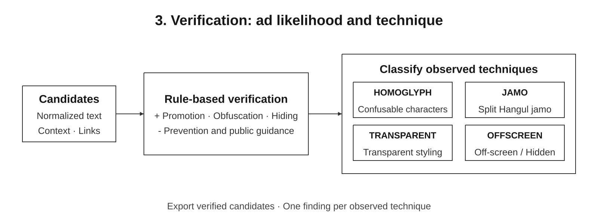

# DOM/CSS Ad Detector

A two-stage illegal ad detector for public-sector websites using Unicode normalization and DOM/CSS analysis.

Scan subpages and nested iframes, review detection evidence, and locate suspicious elements precisely. Runs on Windows 11 without a dedicated GPU or an external AI API.

**[Quick start](#quick-start) · [How it works](#how-it-works) · [Documentation](#documentation) · [Limitations](docs/KNOWN_LIMITATIONS.md)**

## Quick start

Requires Windows 11 x64 and Python 3.11 or later. Run these commands from the repository root:

```powershell
python -m venv .venv
.\.venv\Scripts\python.exe -m pip install -r requirements-lock.txt
.\.venv\Scripts\python.exe -m playwright install chromium
.\.venv\Scripts\python.exe main.py
```

The lock file records the previously validated Windows environment. If those wheels are unavailable for your Python version, install `requirements.txt` and rerun the tests.

For a command-line scan:

```powershell
.\.venv\Scripts\python.exe main.py --url https://example.go.kr --config config.example.json --output result.json
```

By default, results are written beside `main.py`, or beside the executable in a packaged release. Review both `result.json` and `scan_details.json` for coverage and errors.

## How it works

1. **Collect:** render pages, follow same-origin links while preserving query strings, and inspect nested frames.
2. **Screen:** retain candidates with relevant keywords, character obfuscation, or CSS concealment indicators.
3. **Verify:** combine promotional wording, public-information context, link characteristics, and observed techniques.
4. **Locate and export:** verify a unique element location and its original text, deduplicate findings, and validate JSON before saving.



| Technique | Evidence inspected |
|---|---|
| `HOMOGLYPH` | Fullwidth characters and a controlled mapping of visually confusable characters |
| `JAMO` | Reconstructed Hangul syllables from separated jamo |
| `TRANSPARENT` | Computed text color, background similarity, and effective ancestor opacity |
| `OFFSCREEN` | Hidden display, extreme positioning, tiny text, and clipping |

The GUI provides scan controls, live counts, filtering, sorting, contextual evidence, URL/selector copying, and JSON export. Authentication and CAPTCHA restrictions are not bypassed.

The interface and documentation are in English. Korean keywords, normalization examples, fixtures, and original evidence intentionally remain in Korean because they are part of the detection data.

## Test and build

```powershell
.\.venv\Scripts\python.exe -m pytest -q
.\build.ps1 -Python .\.venv\Scripts\python.exe
```

Build output is placed in `release/PublicWebAdDetector/`. Distribute the executable together with `_internal`. Generated binaries, Chromium, environments, and test output are excluded from Git; publish binary archives separately through GitHub Releases.

## Repository layout

```text
dom_css_ad_detector/
├── detector/                 # Crawling, screening, verification, locations, JSON, GUI
├── tests/                    # Unit, browser, and GUI tests; local fixture site
├── docs/                     # Manuals, requirements, limitations, validation report
│   ├── images/               # English SVG diagrams
│   └── validation/           # Historical packaged-release validation records
├── schemas/result.schema.json
├── main.py
├── config.example.json
├── requirements.txt
├── requirements-lock.txt
├── build.ps1
├── LICENSE
└── THIRD_PARTY_NOTICES.md
```

Fresh test runs write to the ignored `test_evidence/` directory. Historical records under `docs/validation/` are preserved separately.

## Documentation

- [User manual](docs/USER_MANUAL.md)
- [Installation, builds, and tests](docs/BUILD.md)
- [Software requirements](docs/SRS.md)
- [Requirements status](docs/REQUIREMENTS_STATUS.md)
- [Historical validation report](docs/TEST_REPORT.md)
- [Known limitations](docs/KNOWN_LIMITATIONS.md)
- [GitHub publishing guide](docs/GITHUB.md)
- [Third-party notices](THIRD_PARTY_NOTICES.md)

## Validation scope

The existing Windows 11 validation passed 12 automated tests. A local set of 16 expected technique findings produced TP 16, FP 0, and FN 0. This small fixture set does not establish performance on real public-sector websites. Official competition schema and `topic` compliance remain unverified.

Click-only comments, infinite scrolling, image OCR, Shadow DOM, and complex concealment have coverage limitations. See [known limitations](docs/KNOWN_LIMITATIONS.md).

## License

Application source is licensed under the [MIT License](LICENSE). Dependencies and bundled components retain their own licenses; see [third-party notices](THIRD_PARTY_NOTICES.md).
